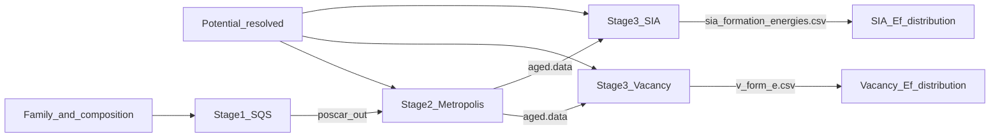

# RCCA Workflow Package

Independent Python package + Streamlit GUI that turns `ex_scripts` (SQS → Metropolis aging → vacancy/SIA formation) into a click-configured, chained local job pack—**without** SIA geometry classification.

## Repo layout (after cleanup)

```text
CCA_Defect/
  rcca_workflow/          # NEW package (this plan)
  gui/                    # NEW Streamlit shell
  ex_scripts/             # frozen method examples (source of truth)
  legacy_icet_sqs/        # previous ICET-SQS Streamlit project (do not port wholesale)
  PLAN.md                 # human-readable summary (mirrors this plan)
  .cursor/plans/          # this file
```

## Source of truth

| Stage | Folder | Driver | Primary outputs |
|-------|--------|--------|-----------------|
| 1 SQS | `ex_scripts/Step1_SQS/` | `W-Ta-Cr-V_SQS.py` + `SQS_METHOD.md` | `poscar_out`, cost/CV files |
| 2 Metropolis | `ex_scripts/Step2_MetroMC/` | `run_metropolis.py` + `MC_METHOD.md` | `aged.data`, `mc_progress.png` |
| 3-1 Vacancy | `ex_scripts/Step3_FormE/Step3-1_V/` | `V_form_e.py` + `vac_METHOD.md` | `v_form_e.csv`, `v_cases/` |
| 3-2 SIA | `ex_scripts/Step3_FormE/Step3-2_SIA/` | `SIA_form_e.py` + `SIA_METHOD.md` | anneal cases + energy CSV only |

**Hard exclusion:** do not port Stage 3-2 Part 3 classification (`load_classifier`, `label_relaxed`, `class_key`, `sia_classes_*.csv`, geometry/orientation/pair fields).

Migration / OKMC = Phase 2 (not in v1).

## Data flow



Each stage writes `manifest.json` (inputs, outputs, seeds, potential hash, composition).

## Implementation order

1. **Package skeleton** — done
2. **Port Stage 1 SQS** — done (`stages/sqs.py`, `stages/sqs_driver.py`, golden shape tests)
3. Port Stage 2 Metropolis; chain from Stage 1 POSCAR
4. Port Stage 3-1 vacancy (`mu`/masses from family)
5. Port Stage 3-2 SIA anneal only (no classification)
6. Streamlit GUI: family → stages → emit/run pack
7. End-to-end dry run on reduced supercell before 5488 defaults

## Target package layout

```text
rcca_workflow/
  family.py
  potential.py
  manifest.py
  stages/
    sqs.py
    metropolis.py
    vacancy.py
    sia.py
  templates/
gui/app.py
ex_scripts/          # frozen
NOTICE / LICENSE
```

## Env-var contracts to model (from examples)

- Shared: `POT_DIR`, `LMP`, `AGED` / `POSCAR`, seeds
- Stage 2: `MPIRUN`, `NPROCS`, `SEED`, `SKIP_RELAX`, stop criteria
- Stage 3-1: `SAMPLES_PER_ELEMENT`, `SITE_SEED`, `NWORKERS`
- Stage 3-2: `ANNEAL_K`, `INSERTS_PER_ELEMENT`, `MD_STEPS`, `COOL_STEPS`
- Family fields: elements, molar ratios, masses, `mu` (eV), potential identity

## Out of scope (v1)

- SIA geometry classification / class CSV
- OKMC pack generation
- Full desktop `.exe` shell
- Hardcoding only W–Ta–Cr–V (demo default only)
