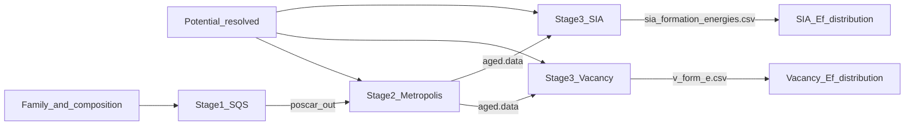

# RCCA Workflow Package (from ex_scripts)

Build an independent Python package + Streamlit GUI that turns the existing `ex_scripts` pipeline (SQS → Metropolis aging → vacancy/SIA formation) into a click-configured, chained local job pack—without SIA geometry classification.

Canonical plan file: [`.cursor/plans/rcca-workflow.plan.md`](.cursor/plans/rcca-workflow.plan.md)

## Todos

- [x] Create `rcca_workflow` package skeleton: Family, Potential, Manifest, stage interfaces
- [x] Parameterize and port Stage 1 SQS from `ex_scripts/Step1_SQS`
- [ ] Port Stage 2 Metropolis aging; chain from Stage 1 POSCAR
- [ ] Port Stage 3-1 vacancy formation with family mu/masses
- [ ] Port Stage 3-2 SIA anneal only; strip all classification logic and class CSV/fields
- [ ] Build Streamlit GUI to configure family/stages and emit chained job packs
- [ ] Validate end-to-end on a reduced supercell before 5488 defaults

## Repo layout

```text
CCA_Defect/
  rcca_workflow/       # product package
  gui/                 # Streamlit shell (step 6)
  ex_scripts/          # frozen method examples (source of truth)
  legacy_icet_sqs/     # previous ICET-SQS Streamlit project (do not merge)
  PLAN.md
  NOTICE
  requirements.txt
```

## Source of truth

Reference implementations live under `ex_scripts/`:

| Stage | Folder | Driver | Primary outputs |
|-------|--------|--------|-----------------|
| 1 SQS | `Step1_SQS/` | `W-Ta-Cr-V_SQS.py` + `SQS_METHOD.md` | `poscar_out`, `final_cost_function.txt`, `final_cluster_vector_deviations.tsv` |
| 2 Metropolis | `Step2_MetroMC/` | `run_metropolis.py` + `MC_METHOD.md` | `relaxed.data` → `aged.data`, `mc_progress.png` |
| 3-1 Vacancy | `Step3_FormE/Step3-1_V/` | `V_form_e.py` + `vac_METHOD.md` | `v_form_e.csv`, `v_cases/vac_*/` |
| 3-2 SIA | `Step3_FormE/Step3-2_SIA/` | `SIA_form_e.py` + `SIA_METHOD.md` | anneal cases + energy CSV only |

Migration / OKMC are **not** in this folder; they stay Phase 2 after formation energy distributions ship.

**Hard exclusion:** do **not** port Stage 3-2 Part 3 classification from `SIA_form_e.py` (`load_classifier`, `label_relaxed`, `class_key`, `write_class_summary`, `sia_classes_*.csv`, or fields `geometry` / `orientation` / `pair` / `element_a` / `element_b` / `class_key`). SIA stage ends at anneal + \(E_f^{\mathrm{SIA}}\) rows.

## Product shape

New independent package (not a continued ICET-SQS fork). Target layout:

```text
rcca_workflow/
  family.py          # elements, molar ratios, masses, mu, potential ref
  potential.py       # resolve POT_DIR / API download → local lockfile
  manifest.py        # stage I/O contracts + chain links
  stages/
    sqs.py           # from Step1 chemistry + plateau MC
    metropolis.py    # from Step2 relax + atom/swap aging
    vacancy.py       # from Step3-1
    sia.py           # from Step3-2 Parts 1–2 + driver, no classify
  templates/         # LAMMPS in.* skeletons (tabgap+eam/fs hybrid)
gui/app.py           # Streamlit: family → stages → emit/run pack
ex_scripts/          # frozen method examples
legacy_icet_sqs/     # archived previous project
NOTICE / LICENSE     # MIT + Lebeda/ICET-SQS attribution for any retained SQS GUI bits
```

Delivery model for v1: **local job-pack generator + optional local runners** (same env-var style as the example scripts). Streamlit Cloud is demo-only later; not required for v1.

## Data flow



Each stage writes a small `manifest.json` (inputs used, outputs produced, seeds, potential hash, composition) so the next stage only needs the previous folder + family config.

## Stage contracts to preserve

### Stage 1 — SQS
- Parameterize the chemistry block only: lattice CIF, `CUTOFFS`, `SUPERCELL_REP` / `TARGET_TOTAL_ATOMS`, `SPECIES`, target concentrations (not only equiatomic).
- Keep `generate_sqs_from_supercells` + Q / cluster-vector checks; keep plateau early-stop behaviour from the server copy.
- Output winner POSCAR for Stage 2.

### Stage 2 — Metropolis aging
- Input: Stage 1 POSCAR. Potential: one `.tabgap` + one `.eam.fs` in `POT_DIR` (current `pair_style hybrid/overlay tabgap eam/fs`).
- Flow: box relax → freeze coords → `fix atom/swap` at 300 K → stop on PE/atom + `frac_interval` stability → `aged.data`.
- Refuse unsafe MPI rank choices (e.g. 16) as in the example.

### Stage 3-1 — Vacancy formation
- \(E_f^V(A) = E_{\mathrm{vac}} - E_{\mathrm{bulk}} + \mu_A\)
- Sample N sites per element; concurrent serial `lmp` workers; CSV columns like the example (`site_id`, `removed_element`, nn counts, energies).
- `mu` and masses come from **family config**, not hardcoded W–Ta–Cr–V constants.

### Stage 3-2 — SIA formation (no classification)
- Keep Zhou-style random insertion (0.8–1.4 Å, reject < 0.7 Å) + anneal protocol: short min → NVT at `ANNEAL_K` → linear cool → full min.
- \(E_f^{\mathrm{SIA}}(A) = E_{\mathrm{SIA}} - E_{\mathrm{bulk}} - \mu_A\) with **inserted** species A.
- CSV keeps job/site/host/inserted/coords/energies/`status`/`note` only — **drop all classifier-derived columns and `sia_classes_*.csv`.**
- Still import shared cell I/O / potential helpers from the vacancy module (as today), without loading `classify_sia_geometry.py`.

## Family + potential (the real coupling point)

- **Family** = element set + potential identity (same ML potential files / API id).
- **Composition** = molar ratios inside that family (GUI can emit one pack or a matrix of packs).
- `potential.resolve(family)`:
  1. local `POT_DIR` with exactly one `.tabgap` and one `.eam.fs`, or
  2. later: API download into `potentials/<family>/<hash>/` + lockfile.
- Store absolute-or-pack-relative paths in manifests so generated `in.lmp` files are not tied to `/home/lammpsuser/...`.

## GUI (Streamlit) v1 pages

1. **Family** — elements, ratios, masses, \(\mu\), potential path/API id, LAMMPS binary / MPI.
2. **Stage 1** — supercell, cutoffs, seeds / plateau / steps; run or emit.
3. **Stage 2** — T, stop criteria, ranks; auto-wire POSCAR from Stage 1.
4. **Stage 3** — samples per element, anneal T / MD lengths, workers; auto-wire `aged.data`; vacancy + SIA toggles.
5. **Pack export** — zip/folder: configs, scripts, manifests, README how to run on cluster.

Reuse ideas from `legacy_icet_sqs/` only where useful (structure upload, download zip). Do not drag donation/sidebar branding or fork relationship into the new product. Retain MIT NOTICE for any copied SQS helper code.

## What v1 explicitly will not do

- SIA geometry classification / class summaries / migration NEB labeling based on classes
- OKMC pack generation (needs migration outputs not present in `ex_scripts`)
- Full Ester-Studio-style `.exe` desktop shell (portable `venv` + launch script is enough later)
- Hardcoding only W–Ta–Cr–V (examples stay as the default demo family)

## Implementation order

1. ~~Package skeleton + `Family` / `Potential` / `Manifest` models matching example env vars.~~ **done**
2. ~~Port Stage 1 driver as parameterized module; golden-check against `ex_scripts/Step1_SQS` outputs shape.~~ **done** (`rcca_workflow/stages/sqs.py` + `sqs_driver.py`; `tests/test_sqs_stage.py`)
3. Port Stage 2; chain from Stage 1 POSCAR.
4. Port Stage 3-1 vacancy.
5. Port Stage 3-2 SIA **with Part 3 deleted**; energy CSV schema without class fields.
6. Streamlit GUI that fills configs and writes a runnable pack directory.
7. One end-to-end dry run on a small supercell (e.g. reduced `SUPERCELL_REP`) to validate chaining before 5488-scale defaults.
